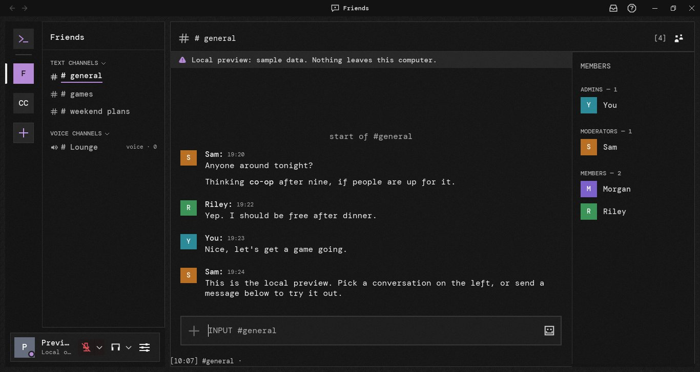
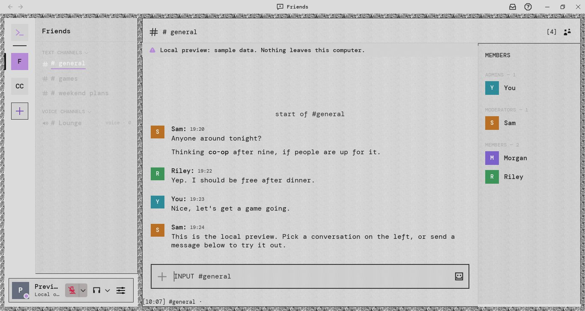

# System24

A theme for [Yapfast](https://github.com/yapfast/yapfast).

Square corners, 2px bordered flat panes with `NAV` / `MEMBERS` / `INPUT` labels and DM Mono throughout give the client system24's terminal look, with a blinking block caret and a faint grain over every surface — scanlines, CRT and the system24 or cats loader art are one option away. Eight flavours (System24, Nord, Tokyo Night, Catppuccin Mocha, Catppuccin Macchiato, Everforest, Rosé Pine, Rosé Pine Moon) come in dark and light variants that follow the app's appearance.

## Install

- In Yapfast, open **Settings > Appearance > Themes**, find **System24** in the marketplace and install it.
- Or paste this repository's URL (`https://github.com/TacticalDeux/system24`) into **Settings > Appearance > Themes > Add from URL**.

## Credits

A port of [system24](https://github.com/refact0r/system24) by [refact0r](https://github.com/refact0r), MIT. The icons are an original square-style set drawn for this port. Type is DM Mono (SIL OFL 1.1), bundled in `fonts/` alongside its licence at `fonts/OFL.txt`. Full terms are in [LICENSE](LICENSE) (MIT AND OFL-1.1); the font licence sits beside the fonts it covers.
